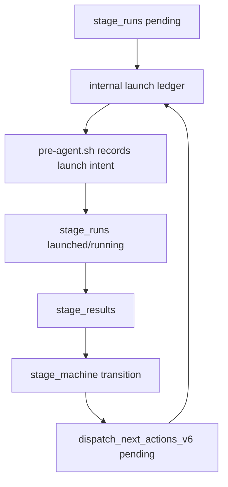

# Dispatch

Status: v6 capability-based dispatch snapshot
Date: 2026-05-26

The v6 canonical flow is:

```text
planner → guardian:provision → implementer → critic → reviewer → guardian:land → planner|terminal
```

## Runtime authority

Dispatch authority lives in `runtime/core/stage_machine.py` and `runtime/core/stage_runs.py`.



## Canonical commands

Create or inspect a stage:

```bash
cc-policy stage graph
cc-policy stage run-create --workflow-id <wf> --stage-id planner --worktree-path <path>
cc-policy stage launch-claim --subagent-type planner --workflow-id <wf> --worktree-path <path>
cc-policy stage start-context --subagent-type planner --workflow-id <wf> --worktree-path <path>
```

Consume next actions:

```bash
cc-policy dispatch next --workflow-id <wf>
cc-policy dispatch next --workflow-id <wf>
```

Submit a result:

```bash
cc-policy stage result-submit <stage_run_id> --payload '{"verdict":"next_work_item","summary":"planned"}'
```

## Launch rule

Canonical role launches for `planner`, `implementer`, `critic`, `reviewer`, and
`guardian` are natural Agent launches. `pre-agent.sh` records launch intent when
it can, but missing or malformed prompt claims do not block the Agent. At
SubagentStart, runtime resolves context by launch tool id, child metadata,
agent id, pending next action, pending/blocked stage run, or natural role stage.
If no stage exists for a canonical role, runtime creates one and injects context.

## Stop rule

Canonical agents end with:

````text
```claude_ctrl_result
{
  "stage_run_id": "<runtime stage run id>",
  "stage_id": "<stage id>",
  "verdict": "<stage verdict>",
  "summary": "<one-line evidence>"
}
```
````

`hooks/v6-result-submit.sh` parses the final block, submits it to runtime,
prepares the next internal launch binding, and reports either:

- `V6_DISPATCH_READY: launch <role> for stage <stage>`;
- `V6_CRITIC_COMPLETE: ... V6_DISPATCH_READY: launch reviewer ...` when external critic succeeds;
- `V6_CRITIC_FALLBACK: ... V6_DISPATCH_READY: launch critic ...` when external critics are unavailable/invalid;
- `V6_STAGE_COMPLETE: ...`; or
- a recovery/status context message.

Connection loss, missing result blocks, hook `ERROR`, and `PROCESS ERROR` are
dispatch-recovery events, not permission for the orchestrator to implement the
task directly. Resume prompts reconcile orphaned launched/running stages through
`stage_runs.reconcile_orphaned_launches()` and relaunch the same role/stage when
no active marker remains. Only a valid `claude_ctrl_result` verdict changes the
semantic route.

`critic` next actions use `worker_pending` while external providers run and are
not launchable until the worker completes or publishes fallback. This prevents a
manual or prompt-router path from bypassing the critic worker.

`hooks/post-task.sh` is retained only for legacy/migration roles and is not part
of active v6 routing.

## Stage transition table

| From | Verdict | To |
|---|---|---|
| planner | `next_work_item` | guardian:provision |
| planner | `goal_complete` | terminal |
| planner | `needs_user_decision` | user |
| planner | `blocked_external` | blocked |
| guardian:provision | `provisioned`, `skipped` | implementer |
| guardian:provision | `denied` | planner |
| implementer | `complete`, `partial` | critic |
| implementer | `blocked` | planner |
| critic | `ready_for_reviewer` | reviewer |
| critic | `try_again` | implementer |
| critic | `blocked_by_plan` | planner |
| critic | `unavailable` | blocked |
| reviewer | `ready_for_guardian` | guardian:land |
| reviewer | `needs_changes` | implementer |
| reviewer | `blocked_by_plan` | planner |
| guardian:land | `landed`, `skipped` | planner |
| guardian:land | `denied` | implementer |

## Single authority

`cc-policy dispatch next` returns pending v6 next actions with `authority: "v6_stage_machine"`. If no v6 action exists, it returns `found:false`; it does not fall back to the legacy dispatch queue.

Legacy trailer hooks remain only as migration parsers for non-canonical seats.
Canonical v6 seats use natural launch binding and `claude_ctrl_result`.

## Validation

```bash
python3 -m pytest -q tests/runtime/test_v6_stage_machine.py tests/runtime/test_v6_critic_worker.py
bash tests/scenarios/test-v6-ticket-flow.sh
bash tests/scenarios/test-v6-critic-auto.sh
```
