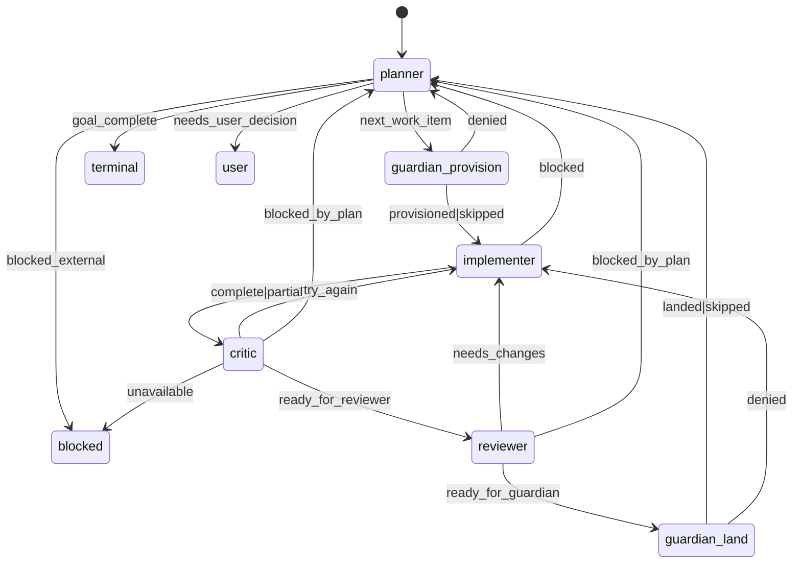
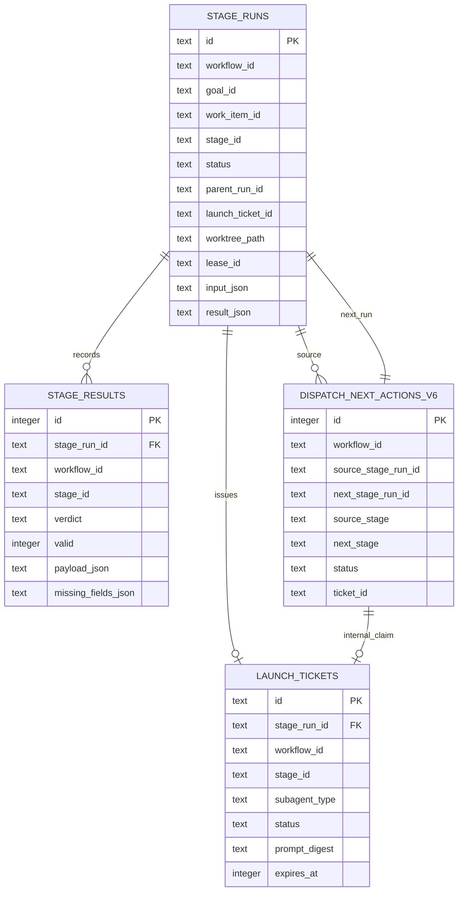
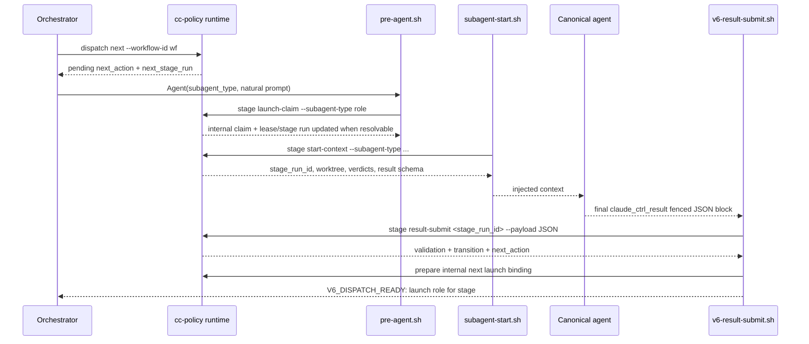
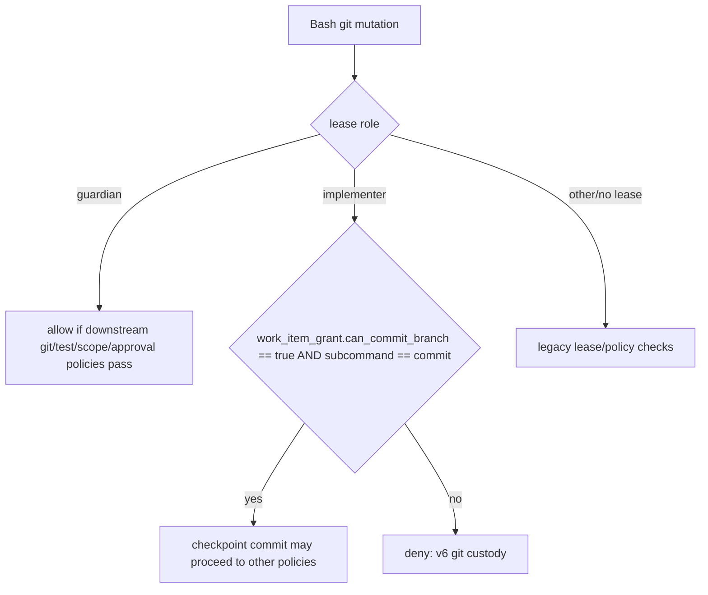

# v6 Architecture — Runtime-Owned Dispatch

Status: current implementation map
Date: 2026-05-26
Source of truth: `runtime/core/stage_machine.py`, `runtime/core/stage_runs.py`, `runtime/cli.py`, `hooks/pre-agent.sh`, `hooks/subagent-start.sh`, `hooks/v6-result-submit.sh`, `settings.json`, and v6 tests.

## Thesis

v6 keeps the v4 ergonomics but moves workflow truth into runtime state:

- one pure stage machine owns transitions;
- one internal launch ledger binds canonical Agent launches;
- one fenced `claude_ctrl_result` JSON block records stage outcomes;
- one Guardian custody path owns git mutation by default;
- hooks are adapters, not independent routers.

## Stage graph



Canonical stage IDs in code:

| Stage | Agent type | Verdicts |
|---|---|---|
| `planner` | `planner` | `next_work_item`, `goal_complete`, `needs_user_decision`, `blocked_external` |
| `guardian:provision` | `guardian` | `provisioned`, `denied`, `skipped` |
| `implementer` | `implementer` | `complete`, `partial`, `blocked` |
| `critic` | `critic` | `ready_for_reviewer`, `try_again`, `blocked_by_plan`, `unavailable` |
| `reviewer` | `reviewer` | `ready_for_guardian`, `needs_changes`, `blocked_by_plan` |
| `guardian:land` | `guardian` | `landed`, `denied`, `skipped` |

## Runtime state model



## Canonical launch sequence



Important behavior:

- `prompt-submit.sh`/`stage bootstrap` creates or reuses runtime stage context and emits natural launch guidance.
- `pre-agent.sh` denies only harness worktree isolation for canonical launches; missing launch claims become context repair work, not authorization failures.
- `subagent-start.sh` resolves by launch id, child metadata, agent id, pending next action, pending/blocked stage run, then natural role/workflow fallback; for `guardian:land`, it recomputes `v6_landing_readiness` at seating time.
- `v6-result-submit.sh` parses the final fenced result block, submits it to `stage_runs.submit_result()`, prepares the next internal launch binding, and emits `V6_DISPATCH_READY`.
- `dispatch next` returns only v6 `dispatch_next_actions_v6`; no legacy dispatch fallback remains.
- Critic is first-order: v6 tries external Codex/Gemini via `critic_runs`; if unavailable it emits a natural launch for an adversarial `critic` subagent.

## Result contract

Every canonical stage must end with a fenced JSON block:

````text
```claude_ctrl_result
{
  "stage_run_id": "<runtime id>",
  "stage_id": "implementer",
  "verdict": "complete",
  "head_sha": "<sha when required>",
  "summary": "one-line evidence summary"
}
```
````

Current validator enforces:

- `verdict` exists and is valid for the stage run's runtime `stage_id`;
- `summary` exists;
- `head_sha` exists for `implementer`, `reviewer`, and `guardian:land`;
- `findings` exists for `reviewer`.

A valid result marks the run `completed`, records `stage_results`, applies the stage-machine transition, creates the next `stage_runs` row, and creates a pending `dispatch_next_actions_v6` row when the destination is active.

## Git custody



v6 changes `bash_git_who.py` so implementers cannot mutate git by default. Guardian owns commits, merges, pushes, worktree lifecycle, stash, branch/ref changes, and landing. The only implemented implementer exception is a scoped checkpoint `git commit` with explicit lease metadata:

```json
{"work_item_grant":{"can_commit_branch":true}}
```

Even with that grant, `git push` and other git mutations remain denied for implementer.

## What is implemented now

| Area | Current state | Test/documented proof |
|---|---|---|
| Pure stage graph | Implemented in `runtime/core/stage_machine.py` | `tests/runtime/test_v6_stage_machine.py::test_stage_graph_core_loop` |
| Impossible transition denial | Implemented via `validate_verdict()` | `test_unknown_transition_fails_closed` |
| Stage run/internal launch/result ledger | Implemented in `runtime/core/stage_runs.py` + schema tables | `test_ticket_claim_and_result_create_next_action` |
| Natural Agent launch binding | Implemented in `hooks/pre-agent.sh` + `stage launch-claim` | `tests/scenarios/test-v6-ticket-flow.sh` |
| Subagent runtime context injection | Implemented with natural repair fallback | `tests/scenarios/test-v6-ticket-flow.sh` |
| Unified result submission hook | Implemented in `hooks/v6-result-submit.sh` | `tests/scenarios/test-v6-ticket-flow.sh` |
| Critic/reviewer seats | Implemented as canonical subagent stages/prompts | `agents/critic.md`, `agents/reviewer.md`, stage graph tests |
| Hidden regular Stop critic gate removal | Implemented in `settings.json` | `settings.json` Stop hooks only run surface/session/forward-motion |
| Implementer git custody | Implemented in `bash_git_who.py` | `tests/runtime/policies/test_v6_git_custody.py` |

## Implemented hardening after first pass

1. **External critic provider runner.** `runtime/core/critic_runner.py` persists `critic_runs`, tries Codex/Gemini providers, and falls back to an explicit adversarial `critic-subagent` launch prompt when external providers are unavailable.
2. **Critic proof enforcement.** `critic` results now require `execution_proof.provider`, `execution_proof.valid=true`, and `findings`.
3. **Convergence loop.** `critic.try_again` routes back to implementer for two rounds, then escalates to reviewer with `retry_limit_exceeded:2` recorded in transition metadata.
4. **Single landing readiness authority.** `runtime/core/landing_readiness.py` collapses reviewer result, tests, scope, head SHA, Guardian lease, and workflow binding into `v6_landing_readiness`. `bash_eval_readiness.py` gates landing on that aggregate, not legacy `evaluation_state`.
5. **Canonical SubagentStart repair.** `planner`, `implementer`, `critic`, `reviewer`, and `guardian` create or repair role context when launch metadata is incomplete.
6. **No legacy dispatch fallback.** `cc-policy dispatch next` now returns only v6 stage-machine actions.
7. **Automatic critic worker.** Implementer results invoke the bounded critic worker immediately; `worker_pending` actions cannot be launch-bound before worker completion/fallback.
8. **Safe migration path.** `scripts/claude-v6-migrate.sh` backs up, verifies, installs, and restores existing Claude config/history state.
9. **Release defaults proven.** Hidden regular Stop review is off by default; deterministic SubagentStop/stage review remains on.

## Remaining gaps / next hardening

- Full provider command templates may need installation-specific tuning for actual Codex/Gemini CLIs on machines with different CLI versions.
- Live disposable-project end-to-end should be recorded before tagging a public release, even though synthetic and runtime smoke tests pass.

## Fast validation commands

```bash
python3 -m py_compile \
  runtime/core/stage_machine.py \
  runtime/core/stage_runs.py \
  runtime/schemas.py \
  runtime/cli.py \
  runtime/core/policies/bash_git_who.py

bash -n hooks/*.sh
python3 -m json.tool settings.json >/dev/null

python3 -m pytest -q \
  tests/runtime/test_completions.py \
  tests/runtime/test_dispatch_engine.py \
  tests/runtime/test_policy_engine.py \
  tests/runtime/policies/test_bash_git_who.py \
  tests/runtime/policies/test_bash_worktree_creation.py \
  tests/runtime/test_v6_stage_machine.py \
  tests/runtime/policies/test_v6_git_custody.py

bash tests/scenarios/test-v6-ticket-flow.sh
bash tests/scenarios/test-v6-prompt-bootstrap.sh
bash tests/scenarios/test-v6-critic-auto.sh
bash tests/scenarios/test-v6-backup-restore.sh
python3 runtime/cli.py doctor
```
